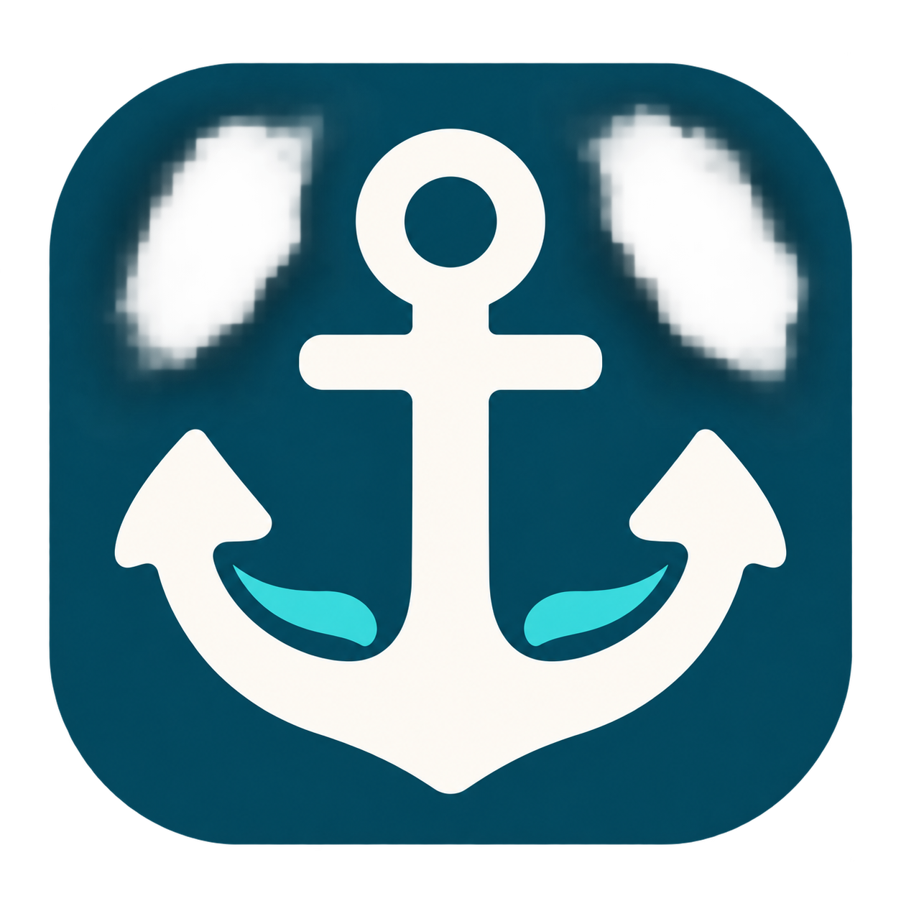

# Harbor



Harbor is a Windows desktop app (Electron + TypeScript) that runs the AI coding CLIs you already have installed and signed in to (Claude Code, Codex, or a CLI you describe yourself) against a local project. You open a folder and describe the work. For each run Harbor picks the CLI, model and effort. It holds no API keys and never calls a model itself.

It is a personal, open-source tool by one developer for one user on one PC. It has no team features, and it makes no promise of saving money or quota ([limitations](docs/limitations.md)).

## Current stage

Working alpha, used by its author. The engine is covered by unit tests that run without network and without real CLIs (`npm test`). Only parts of it have been run against real CLIs. [Limitations](docs/limitations.md) lists what has been verified and what has not. The renderer/main contract is at version 0.1.45 (`src/shared/CHANGELOG.md`).

## How it works

1. A cheap **concierge** answers simple messages itself or escalates. It runs with no tools. Obvious work, `/deep`, go-aheads, named CLIs and images skip it.
2. A **lead** (a normal CLI session in your project folder, resumed every turn) does the work.
3. When splitting the work pays off, the lead prints `HARBOR_DELEGATE` lines. Harbor then schedules **helpers** (planner, implementer, reviewer, other). Edit helpers each work in their own git worktree on a `harbor/<slug>` branch. Helpers never start agents of their own.
4. Harbor runs your checks (`.harbor/checks.json`, after you approve them). A Harbor-run **integrator** (plain git, no model) merges only approved branches into a `harbor/integrate-*` branch. Your branch moves only when you press **Apply**, and only as a fast-forward. **Rollback** reverts a task's merge commits on a `harbor/rollback-*` branch, which you also Apply. Harbor never pushes.
5. Several conversations of one project can run at once. Their leads can see each other and send short `HARBOR_PEER` notes. Only one lead at a time edits the project folder.

Modes: `default` asks before risky tools, `plan` is read-only, `goal` keeps going until the goal is reported done (at most 8 continuations), and `auto` asks for nothing. A new message can **steer** a running turn: it interrupts the turn and starts a new one. **Stop** on a lead stops the open conversation's running turn and its helpers; other conversations of the project keep running.

Other features, all built on plain text lines and files so that any CLI can use them: skills (a library plus per-project choices), an MCP server registry passed to each CLI in its own format, custom CLIs described as data, screenshots (only after you approve each one), a read-only document viewer, export and import of project bundles (`.harbor.zip`), and import of chats from Claude Code, Codex, and claude.ai or ChatGPT exports, project knowledge (short advisory notes the lead writes with `HARBOR_NOTE`, plus a repository map given to helpers), spend ceilings, a secret scan of helper work, a per-task cost and time report, and an optional remote API (below). You can open any project or helper worktree in a terminal, your editor or Explorer. Details: [architecture](docs/architecture.md).

## Routing and usage (estimates)

Routing picks, for each run, the cheapest model and effort that clears a capability floor. The floor comes from a 0-10 difficulty that Harbor computes. Prices come from the state of your quota pools. Each decision stores its reason and a plain summary on the message. Usage figures come in two kinds:

- **Reported** figures are read from the provider's own data: Claude's `rate_limit_event` during Harbor runs, and Codex's local session logs. They can be stale.
- **Estimated** figures come from Harbor's own runs and are labelled as estimates. Harbor cannot see use outside Harbor. Never read an estimate as your provider quota.

**Spend ceilings** (optional, per task, 24 hours or 7 days, in k-tokens and agent-minutes) stop runs when Harbor's own estimate reaches them, after asking you. They are also estimates from Harbor's runs only.

Every constant in the budget code is a starting value tuned in a simulator, not a provider fact. See [routing and usage](docs/routing-and-usage.md).

**Free resets:** none are offered. The code has a dormant path that could propose a reset through a permission prompt, but it only activates when an entitlement source reports one, and no such source exists (`freeResetAvailable` is never set). Harbor will never use a reset without an explicit yes.

## Terms of service: OWNER TO DECIDE

**Question:** Do the providers' terms for consumer subscription plans (Claude Code on a Claude plan, Codex on a ChatGPT plan) allow driving their CLIs headlessly, automatically and several at a time, as Harbor does?

**What the code does** (facts, not a position):
- It starts the vendor's own CLI as a child process in its documented non-interactive mode (`claude -p --output-format stream-json`, `codex exec --json`) and sends the prompt on stdin.
- It uses whatever account that CLI is already signed in to. Sign-in is always the CLI's own flow. Harbor never reads, stores or forwards credentials or tokens, and it has no API keys and no API fallback.
- It is meant for one person using their own subscriptions on their own PC. There is no multi-account pooling, no account sharing and no hosted service. The roadmap lists "multi-account pools", which would bear on this question. The optional remote API (below) lets you drive your own Harbor; it does not share accounts.
- It runs CLI processes in parallel and without a person at the keyboard: up to 3 helpers at a time (limited further by the quota budget and the concurrency setting), leads in several conversations or projects at once, up to 12 automatic lead turns per user message, and goal mode.
- It tracks usage against the provider's 5-hour and weekly windows, holds a reserve for your interactive work, and stops on rate limits. It does not try to get around any limit.

**Position:** OWNER TO DECIDE. The provider terms have not been researched in this repository. Until the owner states a position, check your plan's terms yourself before using Harbor.

## Install and update

Download `Harbor-Setup-<version>.exe` from [GitHub Releases](https://github.com/Zemodeler/Harbor/releases). Windows only.

- The installer is not code-signed, so SmartScreen warns on the first install. Choose **More info**, then **Run anyway**.
- Harbor updates itself from GitHub Releases. It checks 30 seconds after launch and then every 4 hours, downloads in the background, and asks before restarting. It never restarts while agents are running. Set `HARBOR_NO_UPDATE=1` to turn updates off.
- Every push to `main` that passes tests, typecheck and build publishes release `0.1.<run number>`. A head commit containing `[skip release]` skips it. See [RELEASING.md](RELEASING.md). The release workflow and a real auto-update have **not** been verified.

Data lives in `%APPDATA%\Harbor\` and survives uninstall. Harbor never deletes a branch.

## First run

Install `claude` and/or `codex` and sign in to them. Harbor finds them on PATH and in common install folders. You can override the location in Settings > Connections or with `HARBOR_CLAUDE_PATH` / `HARBOR_CODEX_PATH`. Gemini CLI is detected but has no built-in adapter in this version (one is in progress); it can be added as a custom CLI.

To let Harbor verify helper work, add `.harbor/checks.json`, for example `{"checks": ["npm test", "npm run typecheck"]}`. Harbor asks you to approve these commands before it runs them.

## Remote API (optional)

Off by default. With `remote.enabled` in Settings (or always under `npm run headless`) Harbor serves `POST /v1/invoke/<method>`, `GET /v1/whoami` and a WebSocket event stream at `/v1/events`, each request carrying `Authorization: Bearer <token>`. It binds to `127.0.0.1:47821` unless you change it; a non-loopback bind needs TLS or an explicit plain-HTTP acknowledgement. Tokens have a scope (`read-only`, `answer-permissions`, `full`; `full` needs `allowFullScope`), are shown once, and only their hash is stored. Opening windows, folders and terminals, sign-in, token management and free resets are never remote. `npm run harbor -- <command>` is a small client. Only one Harbor (app or headless) may use a data folder at a time. Details: [safety](docs/safety.md). It is covered by unit tests only, not verified with real remote clients.

## Roadmap

Plans: `PLAN-roadmap-2.md` (2026-10-14; spend ceilings, secret scan, eval harness, task report, project knowledge, repo map and the remote API are merged) and `PLAN-roadmap-3.md` (2026-10-21; in progress on separate branches: project create/clone/delete and publishing, reliability, a Gemini adapter, these docs). Nothing in roadmap 3 is in the app until merged. Still open: hands-on verification of the Codex adapter and model ids, more git/PR/CI features, more providers, storage, and UI polish.

Linux is deferred. Mobile and macOS are out of scope. Open work items are in [BACKLOG.md](BACKLOG.md).

## Development

```
npm install      # then: node node_modules/electron/install.js if electron/dist is missing
npm run dev
npm test && npm run typecheck && npm run build   # all three must pass
npm run smoke    # real CLI check, uses a little subscription quota
npm run eval     # Harbor vs a single agent; fake adapters by default, `--real --yes` spends quota
```

Rules and file ownership: [AGENTS.md](AGENTS.md). License: MIT ([LICENSE](LICENSE)).

## Docs

[Architecture](docs/architecture.md) · [Safety](docs/safety.md) · [Routing and usage](docs/routing-and-usage.md) · [Limitations](docs/limitations.md) · [Releasing](RELEASING.md)
